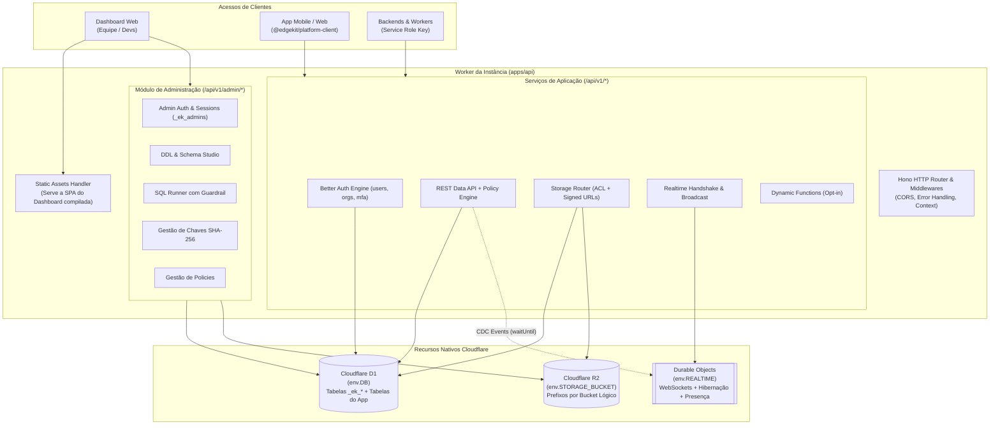

# 03. Arquitetura e Modelo de Instância

> Detalhamento da topologia técnica, modelo de instância autônoma (1 Deploy = 1 Projeto) e infraestrutura nativa na Cloudflare.

---

## 1. Topologia da Instância

O Edgekit Platform adota a abordagem **Single-Instance**: cada aplicação desenvolvida é empacotada como uma unidade autônoma executando sobre a infraestrutura global da Cloudflare.

---

## 2. Eliminação de Complexidade Artificial

Ao optar por **1 Deploy = 1 Projeto**, eliminamos problemas operacionais comuns em arquiteturas multi-tenant centralizadas:

1. **Zero RPCs Internos:** Não há necessidade de gerenciar múltiplos Workers com Service Bindings ou orquestração complexa.
2. **Bindings Estáticos e Confiáveis:** As conexões com `env.DB`, `env.STORAGE_BUCKET` e `env.REALTIME` são configuradas diretamente no `wrangler.jsonc`. Não há geração dinâmica de bindings via chamadas à API da Cloudflare em runtime.
3. **Isolamento de Runtime Garantido pela Cloudflare:** Se o projeto A sofrer um ataque de negação de serviço (DDoS) ou consumir limites, o projeto B (em outro Worker e banco) continua operando sem qualquer interferência.
4. **Sem Chaves Mestras de Infraestrutura em Produção:** O Worker em produção não precisa armazenar tokens de API da conta Cloudflare do desenvolvedor, pois o provisionamento de recursos ocorre na máquina local durante o build/deploy via Wrangler.

---

## 3. Gestão de Ambientes (Dev, Staging e Prod)

Em vez de criar um sistema complexo de branching e ambientes dentro do banco de dados, o Edgekit Platform aproveita os ambientes nativos do ecossistema Cloudflare / Wrangler:

### 3.1. Ambiente Local (Desenvolvimento Gratuito e Ilimitado)
- Comando: `pnpm dev` ou execução direta de scripts/testes com Node.js/Vitest.
- O Wrangler inicializa o simulador **Miniflare** para testar bindings de Workers/D1/R2/DO.
- Para scripts de automação, Drizzle Kit (`db:generate`, `db:studio`) e testes rápidos fora do isolamento do Worker, o motor **`better-sqlite3`** atua como driver SQLite local conectando-se a `dev.db`.
- Não consome nenhum recurso nem cota na nuvem da Cloudflare durante o desenvolvimento.

### 3.2. Ambientes de Staging e Produção
- Produção: `pnpm deploy` (publica o Worker principal com bindings de produção).
- Staging / Preview: `pnpm deploy --env staging` (publica uma instância isolada com `d1_databases` e `r2_buckets` distintos definidos no `wrangler.jsonc`).
- Cada ambiente conta com seus próprios dados, suas próprias chaves e suas próprias configurações de autenticação.

---

## 4. Capacidades e Limites Nativos

Como a instância roda sobre o ecossistema Cloudflare, ela herda os limites da conta do desenvolvedor:

| Recurso | Plano Free da Cloudflare | Plano Workers Paid ($5/mês) |
|---|---|---|
| **Bancos D1 por Conta** | 10 bancos (até 10 instâncias gratuitas) | Até 1.000.000 bancos |
| **Tamanho por Banco D1** | 500 MB por banco (5 GB total na conta) | 10 GB por banco (1 TB total na conta) |
| **Operações D1** | 5 milhões de leituras / dia 100 mil escritas / dia | 25 bilhões leituras / mês 50 milhões escritas / mês |
| **Armazenamento R2** | 10 GB gratuitos (sem taxa de egress) | Apenas custo de uso excedente padrão |
| **WebSockets (Durable Objects)** | 100 mil requisições/dia + hibernação inclusa | Ilimitado sob demanda |
| **Edge Functions Dinâmicas** | Desabilitado por padrão (`ENABLE_FUNCTIONS=false`) | Disponível via Worker Loader / Dynamic Workers |
