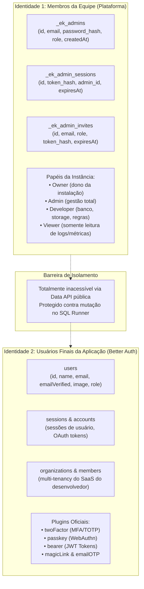

# 04. Identidade, Segurança e Autorização

> Especificação do modelo de dupla identidade (Equipe vs. Usuários Finais), armazenamento criptográfico de chaves, Setup Wizard seguro e Policy Engine (cláusulas SQL `WHERE`).

---

## 1. Separação Estrita de Identidades

O Edgekit Platform estabelece uma barreira absoluta entre quem **opera a plataforma** e quem **usa a aplicação do desenvolvedor**:



### 1.1. Membros da Equipe (`_ek_admins`)
- Acesso restrito ao Dashboard Admin (`/`) e rotas administrativas (`/api/v1/admin/*`).
- Autenticação própria com senha com hash seguro (Argon2id ou Scrypt) e cookies HttpOnly estritos (`__Host-` quando em HTTPS).
- Papéis claros de governança:
  - **Owner:** Cria a instalação, configura domínios e tem poder de transferir a propriedade.
  - **Admin:** Convida novos desenvolvedores, altera chaves de API e gerencia tabelas.
  - **Developer:** Cria e altera tabelas, edita regras de acesso, consulta logs e gerencia arquivos.
  - **Viewer:** Visualiza métricas, logs e registros no Database Studio sem poder alterar nada nem visualizar segredos.

### 1.2. Usuários Finais do App (`users`)
- Gerenciados pelo **Better Auth** diretamente no banco D1 da aplicação.
- Acessam a API pública usando chaves anônimas (`anon_key`) acompanhadas de Bearer Tokens (JWT) ou cookies de sessão gerados pelo Better Auth.
- Podem usufruir de organizações (`organizations`, `members`) no SaaS do desenvolvedor.
- **Nunca ganham acesso ao painel do Edgekit Platform**, mesmo se possuírem campo `role='admin'` dentro da tabela `users` do app.

---

## 2. Setup Wizard Seguro (1º Acesso)

Para eliminar a falha de tomada de controle (achado **C2** do código legado):

1. **Setup Inicial:** O endpoint `POST /api/v1/admin/setup` só aceita requisição se a tabela `_ek_admins` estiver vazia (`count == 0`).
2. **Proteção por SETUP_TOKEN:**
   - Durante o primeiro deploy ou execução do script de setup, um token criptográfico aleatório (`SETUP_TOKEN`) é gerado e armazenado nas variáveis secretas do Worker.
   - O Setup Wizard exige o envio desse token para autorizar o cadastro do **Owner**.
3. **Fechamento Automático:**
   - Logo após o cadastro bem-sucedido do Owner, a rota `/api/v1/admin/setup` passa a responder `403 Forbidden` permanentemente.
   - Qualquer novo membro da equipe só poderá entrar via **Convite** criado pelo Owner ou por um Admin dentro do painel autenticado.

---

## 3. Gestão Criptográfica de Chaves de API (`_ek_api_keys`)

Chaves nunca são salvas em texto puro no banco (eliminando os achados **C1** e **C6**):

- **Chave Pública (`anon`):** Formato `ek_anon_<uuid>`. Permite requisições públicas de frontends e aplicações mobile, submetidas às regras de acesso de cada tabela/bucket.
- **Chave de Serviço (`service_role`):** Formato `ek_sec_<uuid>`. Destinada exclusivamente a scripts de backend seguros; ignora regras de acesso (bypass total). O gateway rejeita requisições com `service_role` originadas diretamente de navegadores normais com cabeçalhos `Origin` não autorizados.
- **Armazenamento:**
  - O banco grava apenas o **hash SHA-256** da chave: `sha256(apiKey)`.
  - Para exibição no painel, grava-se apenas o prefixo identificador (ex.: `ek_anon_abc12...`).
  - No momento da requisição, o middleware calcula o SHA-256 do header `apikey` ou `Authorization: Bearer` e consulta o banco por igualdade de hash.

---

## 4. Policy Engine (Regras de Acesso Compiladas em SQL)

Como o SQLite/D1 não possui Row Level Security nativo, o Edgekit Platform adota a abordagem eficiente do **PocketBase**: compilar regras declarativas diretamente em cláusulas `WHERE` parametrizadas nas consultas geradas pela Data API.

### 4.1. Filosofia: Deny-by-Default (Fechado por Padrão)
Qualquer tabela criada inicia com acesso restrito a `service_role`. Sem uma política configurada, clientes anônimos e usuários comuns recebem `403 Forbidden`.

### 4.2. Presets Nativos Integrados ao Better Auth

As regras podem ser definidas individualmente para `SELECT`, `INSERT`, `UPDATE` e `DELETE`:

| Regra | Condição de Autorização | Cláusula Injetada no SQL |
|---|---|---|
| `disabled` / `service_only` | Apenas `service_role_key` | Não permite chamadas públicas |
| `public` | Qualquer requisição válida com `anon_key` | Sem restrição adicional de linha |
| `authenticated` | Usuário logado (`auth.uid != null`) | Sem restrição adicional de linha |
| `owner` | Restringe ao próprio dono do registro | `WHERE \`<owner_col>\` = :authUid` |
| `org_member` | Restringe aos membros da organização ativa do Better Auth | `WHERE \`<org_col>\` = :activeOrgId` |
| `custom_sql` | Expressão segura parametrizada | Validação e injeção de parâmetros (`@auth.id`, `@auth.role`) |

### 4.3. Exemplo Prático de Compilação

Para uma requisição `GET /api/v1/db/documents` vinda de um usuário autenticado com ID `usr_123` em uma tabela com regra `owner` na coluna `author_id`:

```sql
-- Query gerada com injeção segura de parâmetros:
SELECT `id`, `title`, `content`, `created_at` 
FROM `documents` 
WHERE `author_id` = ?
ORDER BY `created_at` DESC 
LIMIT 20;
-- Parâmetro: ['usr_123']
```

No caso de um `POST /api/v1/db/documents` (criação):
- A Policy Engine injeta automaticamente `author_id = 'usr_123'` no payload a ser inserido, impedindo que o cliente falsifique a autoria do registro.
