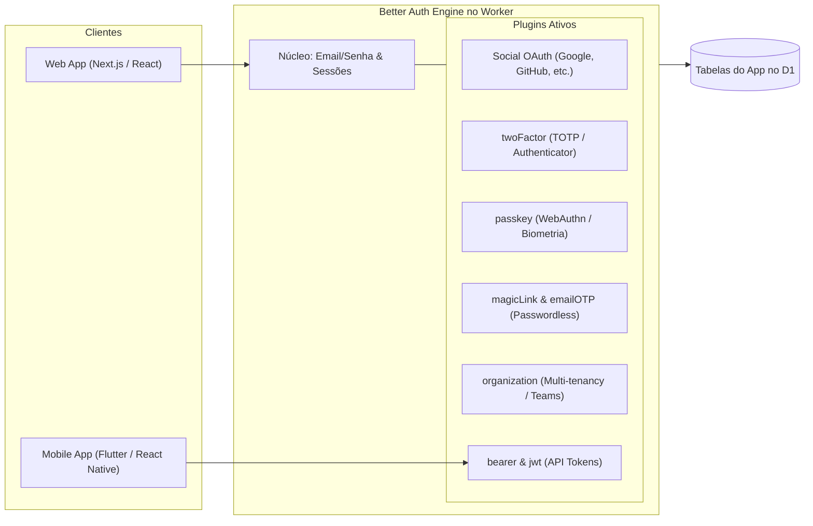

# 05. Serviços Nativos

> Detalhamento da implementação dos serviços nativos do Edgekit Platform: Database, Authentication, Storage, Realtime, Webhooks e Functions.

---

## 1. Database (Cloudflare D1 & REST Data API)

O módulo de banco de dados combina a performance do **Cloudflare D1 (SQLite distribuído)** com uma API REST fluente inspirada no Supabase e PocketBase.

### 1.1. Data API REST (`/api/v1/db/:table`)
- **Filtros Avançados:** Operadores tipados suportados via query string:
  - `col=eq:valor` ou `col=valor` (igualdade)
  - `col=neq:valor` (diferente)
  - `col=gt:valor`, `col=gte:valor` (maior / maior ou igual)
  - `col=lt:valor`, `col=lte:valor` (menor / menor ou igual)
  - `col=like:%termo%` (busca textual)
  - `col=in:val1,val2,val3` (pertence à lista)
  - `col=is:null` / `col=is:not_null` (nulo)
- **Seleção de Colunas:** `?select=id,name,email` com sanitização estrita de identificadores.
- **Paginação e Ordenação:** `?limit=25&offset=50&order=created_at.desc`.
- **Relacionamentos (Foreign Keys):** Capacidade de expandir entidades relacionadas (`?select=*,author(name,avatar)`) aplicando as regras de acesso da tabela referenciada.
- **Operações em Lote Transacionais:** Suporte a inserções e mutações em lote usando o método atômico `db.batch([])` nativo do D1.

### 1.2. Database Studio no Dashboard
- **Visualizador e Editor de Dados:** Interface em grade estilo planilha para visualizar, ordenar, filtrar, editar células e excluir linhas.
- **Visual DDL Studio:** Criação e alteração visual de tabelas, tipos de colunas (`TEXT`, `INTEGER`, `REAL`, `BLOB`, `JSON`), restrições (`NOT NULL`, `PRIMARY KEY`, `DEFAULT`), índices e chaves estrangeiras.
- **SQL Runner com Guardrails:** Terminal SQL completo para administradores da equipe, com proteção automática que bloqueia mutações arbitrárias em tabelas de sistema (`_ek_*`).

---

## 2. Authentication (Better Auth & Plugins Oficiais)

Em vez de reinventar mecanismos de autenticação, o Edgekit Platform adota nativamente o **Better Auth** integrado ao banco D1 da aplicação:

- **Multi-tenancy Pronto no App:** Com o plugin `organization`, o desenvolvedor que cria um SaaS já tem suporte a times, convites de membros e atribuição de papéis (`owner`, `admin`, `member`) sem escrever código adicional.
- **Autenticação Passwordless e Moderna:** Magic Links, códigos OTP por e-mail e Passkeys nativas suportadas out-of-the-box.
- **MFA / 2FA:** Suporte a códigos TOTP via Google Authenticator, 1Password, etc.
- **Transversalidade:** As sessões ativas fornecem o contexto de usuário (`auth.uid`, `auth.role`, `auth.orgId`) que alimenta a Policy Engine do banco e do storage.

---

## 3. Storage (Cloudflare R2 & Buckets Lógicos)

O serviço de armazenamento organiza os arquivos dentro de um único bucket físico no Cloudflare R2 (`env.STORAGE_BUCKET`), particionado logicamente:

### 3.1. Buckets Lógicos (`_ek_storage_buckets`)
Cada bucket criado (ex.: `avatars`, `public-docs`, `invoices`) possui:
- **Visibilidade:** `public` (arquivos servidos com cache longo) ou `private` (acesso restrito por permissão ou URL assinada).
- **Políticas de Acesso:** Regras declarativas para upload, download e exclusão (`public`, `authenticated`, `owner`, `service_only`).
- **Validação de Conteúdo:** Tamanho máximo de arquivo permitido (ex.: 5 MB) e whitelist de MIME types (ex.: `["image/png", "image/jpeg"]`).

### 3.2. URLs Assinadas (Signed URLs)
- Geração de URLs temporárias assinadas via HMAC-SHA256 (`/api/v1/storage/:bucket/signed?token=...`).
- Permite que aplicações baixem ou enviem arquivos privados diretamente sem expor a chave de serviço.

---

## 4. Realtime (Durable Objects com Hibernação)

Construído sobre **Durable Objects com a WebSocket Hibernation API** da Cloudflare para suportar conexões de longo prazo com custo e consumo de memória mínimos:

### 4.1. Persistência de Presença durante Hibernação
- O erro do código legado (perda de estado em `Map` na memória) é resolvido usando `ws.serializeAttachment({ userId, userName, channel, role })`.
- Quando o Durable Object acorda da hibernação para processar uma mensagem, ele recupera todos os clientes ativos usando `this.ctx.getWebSockets(channel)` e `ws.deserializeAttachment()`.

### 4.2. Autorização de Canais e Proteção de CDC
- **Canais `db:<table>`:**
  - Clientes WebSocket **não podem** enviar mensagens manuais para canais `db:*` (bloqueio total de broadcast externo).
  - O evento de CDC (Change Data Capture) gerado nas mutações do banco de dados passa pela Policy Engine antes de ser encaminhado.
  - Se a tabela tiver regra `owner`, o Durable Object só entrega a notificação aos sockets cujo `userId` anexado corresponde ao dono do registro alterado.
- **Canais Customizados (`room:*`, `broadcast:*`):**
  - Autenticação obrigatória no handshake WebSocket.
  - Permite troca de mensagens pub/sub e sincronização de presença entre múltiplos usuários conectados.

---

## 5. Webhooks & Eventos do Sistema

- **Gatilhos Automáticos:** Operações de banco (`INSERT`, `UPDATE`, `DELETE`) e de autenticação (`user.created`, `user.deleted`) geram eventos estruturados.
- **Disparo Confiável:** Processado em segundo plano via `executionCtx.waitUntil`, sem bloquear o tempo de resposta da requisição do usuário.
- **Assinatura HMAC:** Cada chamada envia o cabeçalho `X-Edgekit-Signature: sha256=...` calculado com o segredo do webhook, garantindo a autenticidade da carga no servidor de destino.

---

## 6. Edge Functions (Flag Opt-in para Plano Pago)

- **Configuração:** Flag `ENABLE_FUNCTIONS=false` por padrão no `.env` e no `wrangler.jsonc`.
- **Comportamento no Plano Free:** As rotas de functions retornam código informativo `501 Not Implemented` e a aba de Functions no Dashboard permanece oculta para não gerar expectativas falsas.
- **Comportamento com Plano Pago:** Quando o usuário possui o plano Workers Paid e habilita `ENABLE_FUNCTIONS=true`, o carregador dinâmico de Workers (Worker Loader / Dynamic Workers) é ativado, permitindo rodar códigos TypeScript/JavaScript isolados sob demanda.
