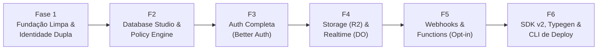

# 07. Roadmap de Implementação e Execução

> Plano de execução estruturado em 6 fases sequenciais para a reconstrução limpa e segura do Edgekit Platform.

---

## 1. Visão Geral das Fases

---

## 2. Detalhamento das Fases

### Fase 1: Fundação Limpa, Segurança & Identidade Dupla
- **Objetivo:** Estabelecer a fundação segura da plataforma, removendo código legado e separando as identidades de equipe e app.
- **Entregas:**
  - Limpeza de arquivos legados órfãos (`do-schema.ts`, `drizzle-do.config.ts`, `plan.ts`, referências a `HonoBase`).
  - Isolamento do `better-sqlite3` para ambiente local / scripts Node, mantendo Cloudflare D1 como alvo de produção.
  - Novo schema Drizzle separando tabelas de sistema `_ek_admins`, `_ek_admin_sessions`, `_ek_admin_invites`, `_ek_api_keys` (com hash SHA-256) das tabelas `users` do app.
  - Setup Wizard seguro com `SETUP_TOKEN` de uso único e fechamento automático permanente.
  - Tela de Login do Dashboard baseada em email/senha de membro da equipe (eliminando o login com service key crua).
  - Middleware unificado de autorização (distinguindo Admin da Plataforma, Usuário do App e Service Role).
- **Critério de Saída:** Teste automatizado validando que um usuário comum do app com `role='admin'` não consegue acessar rotas `/api/v1/admin/*`, e que o `/setup` bloqueia novas tentativas após a criação do Owner.

---

### Fase 2: Database Studio & Policy Engine
- **Objetivo:** Construir a camada de banco de dados com a Data API completa e o motor de regras declarativas (Deny-by-default).
- **Entregas:**
  - Motor de regras (Policy Engine) traduzindo presets (`disabled`, `public`, `authenticated`, `owner`, `org_member`, `custom_sql`) em cláusulas SQL `WHERE` parametrizadas seguras.
  - REST Data API completa suportando filtros encadeados (`eq`, `neq`, `gt`, `gte`, `lt`, `lte`, `like`, `in`, `is_null`), ordenação, paginação e execução atômica via `db.batch([])`.
  - Refatoração da página monolítica `DatabasePage.tsx` no frontend, quebrando-a em subcomponentes modulares:
    - Visualizador de Tabelas estilo planilha.
    - Editor Visual de DDL (colunas, tipos, índices e FKs).
    - Editor de Políticas por tabela.
    - SQL Runner protegido (bloqueio de mutação em `_ek_*`).
- **Critério de Saída:** Testes garantindo que tabelas sem política retornam 403, e que um usuário sob regra `owner` nunca consegue ler nem modificar linhas de outros usuários.

---

### Fase 3: Authentication Completa (Better Auth Plugins)
- **Objetivo:** Entregar aos desenvolvedores um sistema completo de autenticação para suas aplicações.
- **Entregas:**
  - Configuração do Better Auth no banco D1 com ativação dos plugins oficiais:
    - `organization` (criação de times, convites e gestão de membros).
    - `twoFactor` (MFA/TOTP).
    - `passkey` (WebAuthn).
    - `magicLink` e `emailOTP` (Passwordless).
    - `bearer` e `jwt` (Sessões e tokens para APIs móveis e SPAs).
  - Aba de Autenticação no Dashboard para visualização e gerenciamento de usuários finais, sessões ativas, organizações e bloqueio de contas (ban).
- **Critério de Saída:** Fluxo E2E de cadastro, login com MFA e criação de organização validado via testes automatizados.

---

### Fase 4: Storage (R2) & Realtime (Durable Objects)
- **Objetivo:** Finalizar os serviços de armazenamento de arquivos e comunicação em tempo real.
- **Entregas:**
  - Implementação de Buckets Lógicos (`_ek_storage_buckets`) com políticas de acesso, restrições de tamanho, validação de MIME types e URLs assinadas (HMAC-SHA256).
  - Refatoração do `RealtimeDurableObject` utilizando a WebSocket Hibernation API e persistência de presença via `serializeAttachment`/`deserializeAttachment`.
  - Proteção de canais Realtime: bloqueio de broadcast externo em `db:*` e entrega seletiva de eventos CDC respeitando as permissões da tabela.
  - Tela de Storage e Realtime Inspector no Dashboard.
- **Critério de Saída:** Teste de presença resistindo à hibernação do Durable Object e validação de que eventos CDC de tabelas privadas não vazam para conexões não autorizadas.

---

### Fase 5: Webhooks, Auditoria & Edge Functions (Opt-in)
- **Objetivo:** Habilitar extensibilidade e observabilidade.
- **Entregas:**
  - Sistema de Webhooks disparados via `ctx.waitUntil` em eventos de banco e auth, com assinatura criptográfica `X-Edgekit-Signature`.
  - Histórico de auditoria em `_ek_audit_logs` registrando ações administrativas (criação de tabelas, alteração de regras, convites de membros).
  - Isolamento do módulo de Edge Functions atrás da flag `ENABLE_FUNCTIONS=false` por padrão.
- **Critério de Saída:** Webhook recebendo evento assinado e validado com sucesso; confirmação de que em contas no plano Free a API não tenta executar Dynamic Workers.

---

### Fase 6: SDK TypeScript v2, Typegen & Automação de Deploy
- **Objetivo:** Consolidar a experiência de desenvolvimento e empacotamento da plataforma.
- **Entregas:**
  - Reescrita do `@edgekit/platform-client` cobrindo Database, Auth, Storage e Realtime.
  - Script `pnpm db:types` gerando definições TypeScript estritas a partir do schema do D1.
  - Script interativo `pnpm setup:cf` para provisionamento em 1 comando na conta Cloudflare do desenvolvedor.
  - Documentação final de instalação e uso no README do projeto.
- **Critério de Saída:** Um projeto de exemplo em Next.js/React integrando com o SDK utilizando autocomplete dos tipos gerados pelo `pnpm db:types`.
